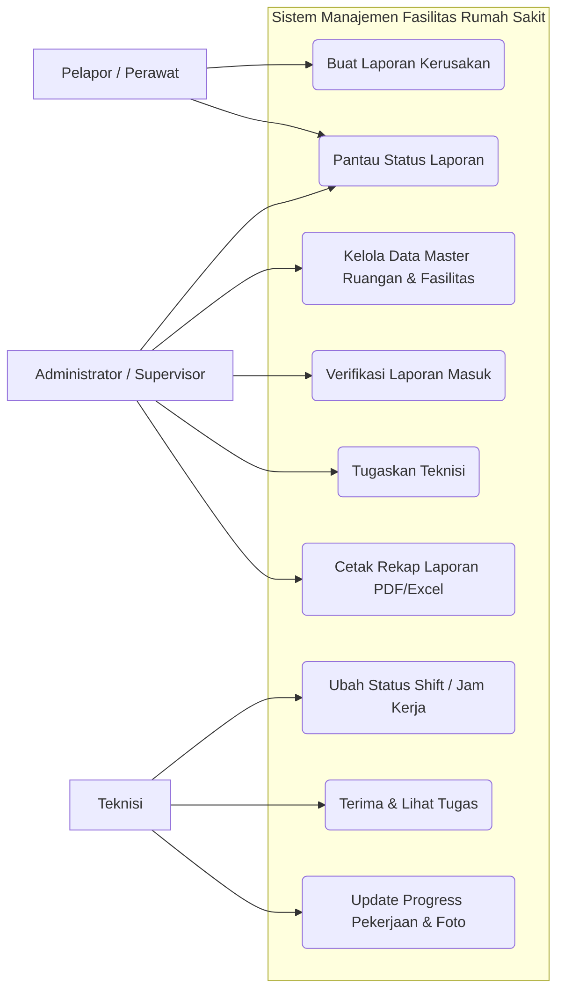
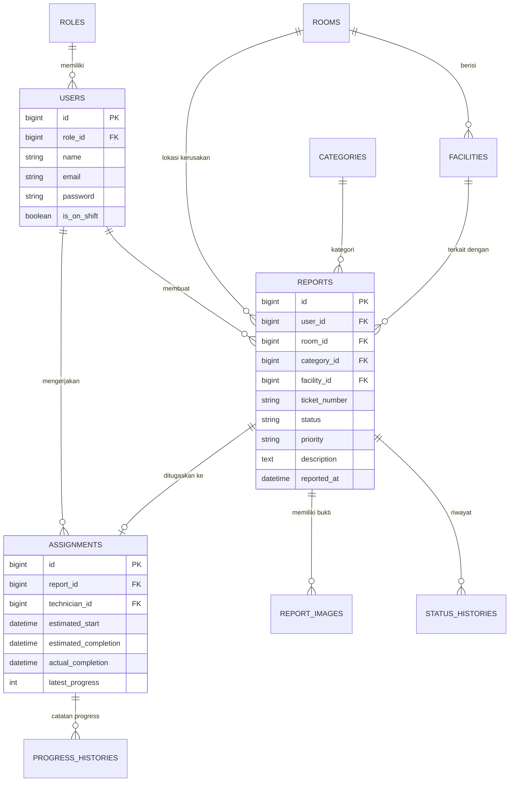
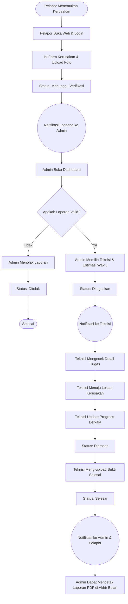

# Dokumentasi Perancangan Sistem (SIMFAS)

Dokumen ini berisi diagram-diagram perancangan sistem yang sangat cocok untuk dimasukkan ke dalam laporan tugas akhir, makalah, atau presentasi Anda.

Anda dapat melihat gambar diagram ini secara langsung dengan meng-copy kodenya dan mem-pastenya di web [Mermaid Live Editor](https://mermaid.live/) atau meng-upload file ini ke GitHub.

## 1. Diagram Use Case (Hak Akses Pengguna)
Diagram ini menjelaskan apa saja yang bisa dilakukan oleh masing-masing pengguna di dalam sistem.

---

## 2. Entity Relationship Diagram (ERD) / Relasi Database
Diagram ini menjelaskan struktur dan hubungan antar tabel di dalam database MySQL sistem kita.

---

## 3. Flowchart Alur Sistem (Proses Bisnis)
Diagram ini menjelaskan perjalanan pelaporan kerusakan dari awal ditemukan sampai selesai diperbaiki.

