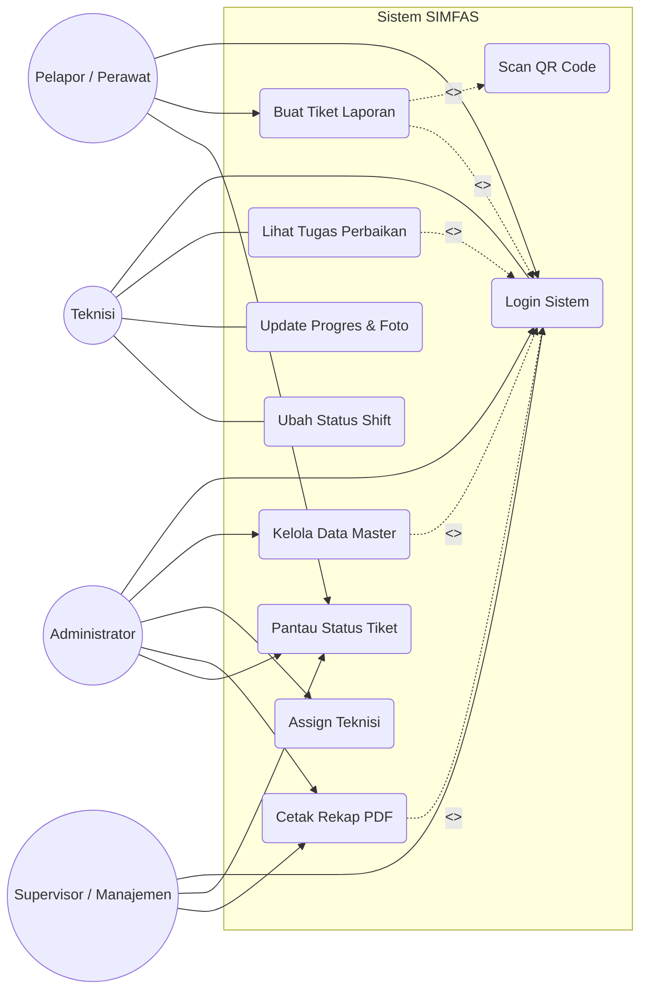
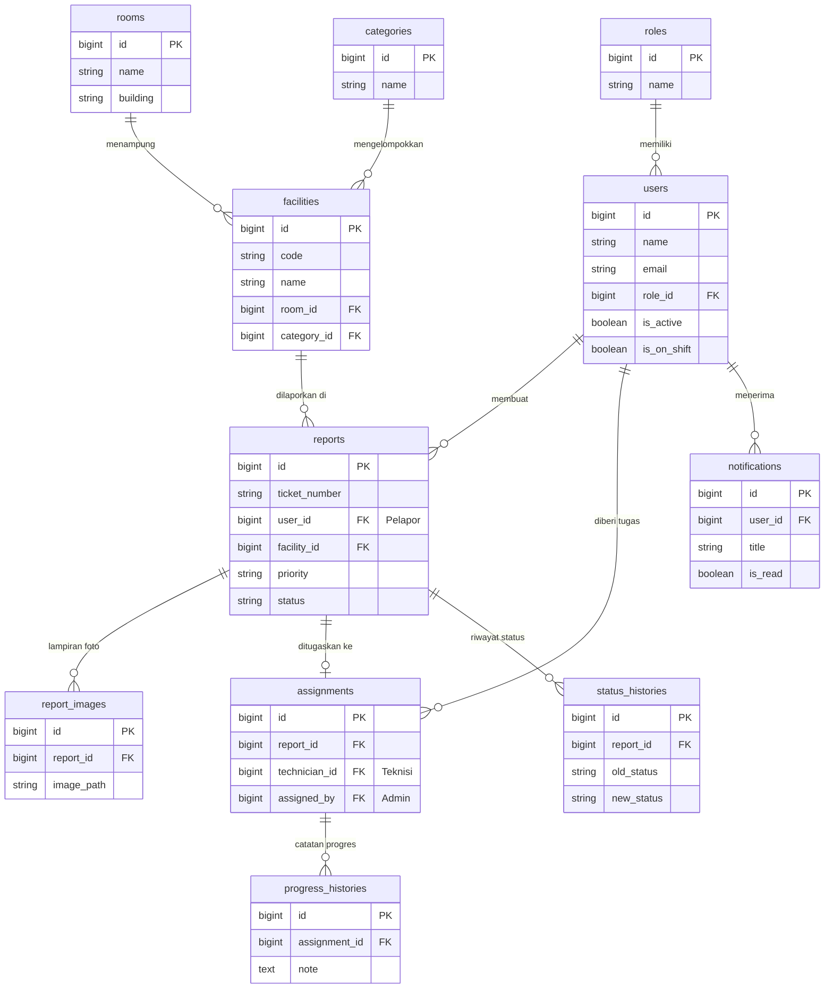
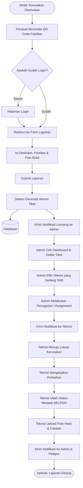

# Dokumentasi Diagram Sistem (SIMFAS)

Dokumen ini berisi kumpulan kode diagram (Mermaid) yang bisa Anda salin untuk men-generate gambar arsitektur sistem secara otomatis.

---

## 1. Use Case Diagram
Menggambarkan interaksi hak akses antara sistem dengan aktor (Pelapor, Teknisi, Admin, Supervisor).

---

## 2. Entity Relationship Diagram (ERD)
Menggambarkan kerangka tabel database dan relasi antar Foreign Key.

---

## 3. Alur Kerja Sistem (Activity Diagram / Flowchart)
Menggambarkan tahapan logis pelaporan dari awal ditemukan sampai diperbaiki.

