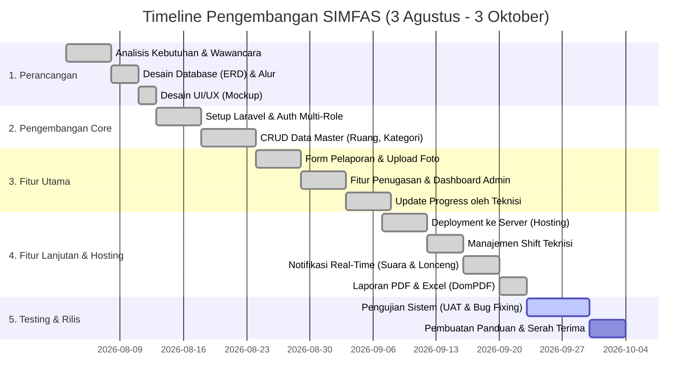

# Timeline Pengembangan Sistem (SIMFAS)

Dokumen ini berisi jadwal dan rancangan waktu (*Timeline*) pengembangan Sistem Informasi Manajemen Fasilitas (SIMFAS) dari tahap awal hingga selesai *(Deployment)*. 

Anda dapat melihat visualisasi *Gantt Chart* di bawah ini dengan meng-copy blok kode Mermaid ke [Mermaid Live Editor](https://mermaid.live/).

## 1. Gantt Chart Pengembangan Sistem
*(Gantt chart adalah grafik batang standar industri untuk menunjukkan jadwal proyek).*

---

## 2. Rincian Fase Pengembangan (SDLC - *Agile / Waterfall*)

Durasi total pengembangan sistem ini adalah **Tepat 2 Bulan (3 Agustus - 3 Oktober)**. Waktu ini dibagi secara proporsional dari tahap wawancara hingga rilis akhir.

### Fase 1: Analisis & Perancangan (3 - 12 Agustus)
*   **Analisis Kebutuhan:** Mengumpulkan masalah di lapangan (contoh: pelaporan via WhatsApp yang tidak tertata).
*   **Perancangan Database:** Membuat ERD yang mencakup tabel *Users, Reports, Rooms, Facilities, Assignments*.
*   **Desain UI/UX:** Merancang antarmuka berbasis *Bootstrap 5* agar ramah digunakan di layar HP pelapor (*Mobile First*).

### Fase 2: Pengembangan Sistem Inti (13 - 23 Agustus)
*   **Instalasi Framework:** Setup Laravel 10 dan pengaturan *Environment* awal.
*   **Autentikasi (Login):** Membuat sistem pembatasan akses (*Middleware*) untuk 4 tingkatan (*Role*): Administrator, Supervisor, Pelapor, dan Teknisi.
*   **Data Master:** Membangun halaman Admin untuk menambah, mengubah, dan menghapus data ruangan serta kategori kerusakan.

### Fase 3: Pengembangan Modul Utama (24 Agustus - 7 September)
*   **Modul Pelapor:** Membuat form pengaduan yang mendukung pilihan kamera langsung dan galeri HP, dengan pembatasan ukuran file.
*   **Modul Penugasan:** Membangun *Dashboard Admin* untuk memverifikasi laporan masuk dan mendistribusikannya ke teknisi beserta perkiraan waktu.
*   **Modul Progress:** Membangun antarmuka teknisi untuk melaporkan persentase pekerjaan (mulai dari *Diproses* hingga *Selesai*) disertai foto bukti selesai.

### Fase 4: Modul Lanjutan & Hosting (Minggu Ke-6, 7 - 22 September)
*   **Deployment (Hosting):** Mengorbitkan *database* dan kodingan lokal ke server *hosting* nyata (InfinityFree / cPanel) lebih awal agar klien dapat memantau progres.
*   **Sistem Kehadiran (Shift):** Mencegah Admin memberikan tugas kepada Teknisi yang sedang libur / lepas dinas.
*   **Notifikasi Cerdas:** Menerapkan *AJAX Polling* untuk menampilkan lonceng merah dan suara *"Ting!"* otomatis tanpa perlu me- *refresh* layar.
*   **Pelaporan (Reporting):** Membangun sistem unduhan dokumen laporan akhir bulan berbentuk PDF menggunakan library *DomPDF*.

### Fase 5: Pengujian & Penyebaran Akhir (23 September - 3 Oktober)
*   **Testing (UAT):** Mencoba berbagai skenario di lapangan langsung melalui *link hosting* (memotret file besar, mencoba login dengan banyak tab, mengecek *bug*).
*   **Penyelesaian Dokumen:** Menyusun manual penggunaan (SOP) dan menyelesaikan dokumentasi sistem (Use Case, Flowchart) untuk diserahkan ke Manajemen RS.
